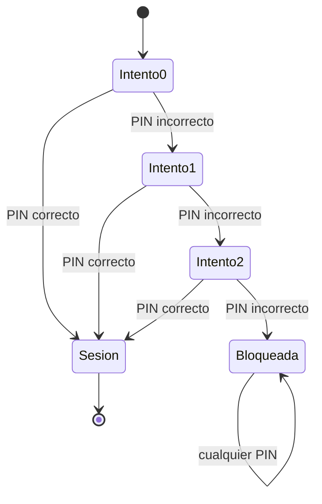
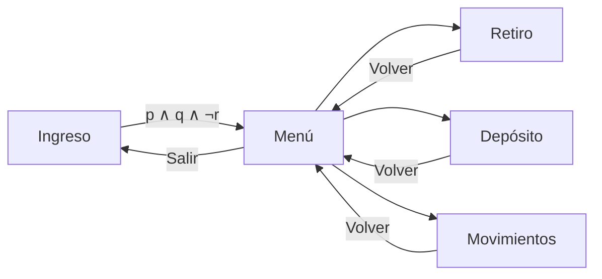
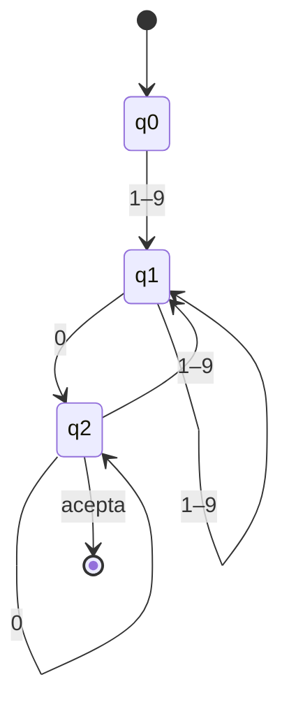
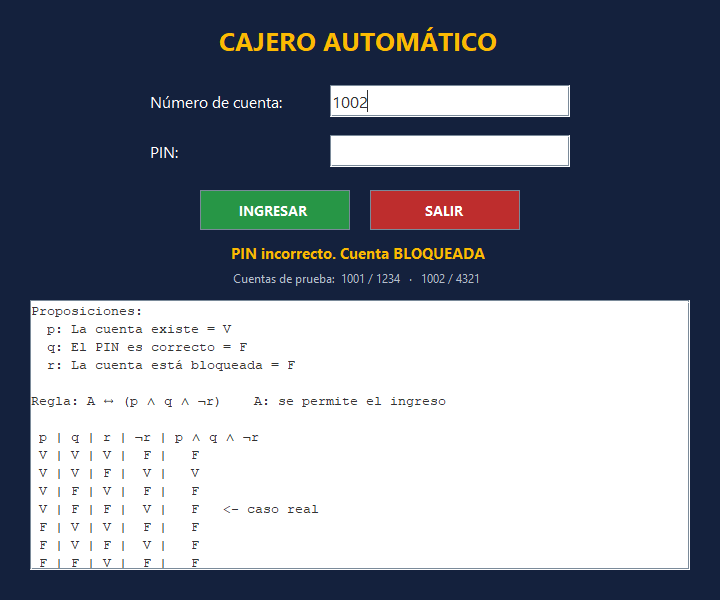
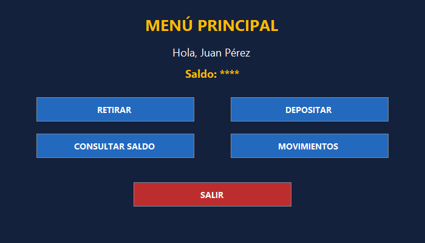
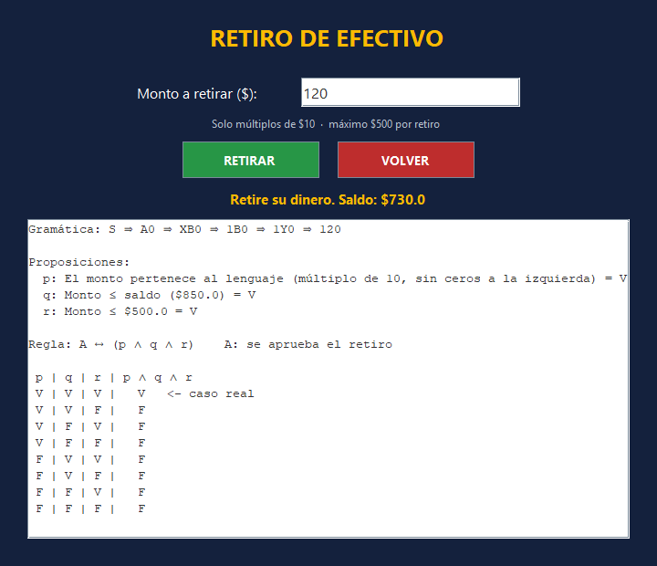
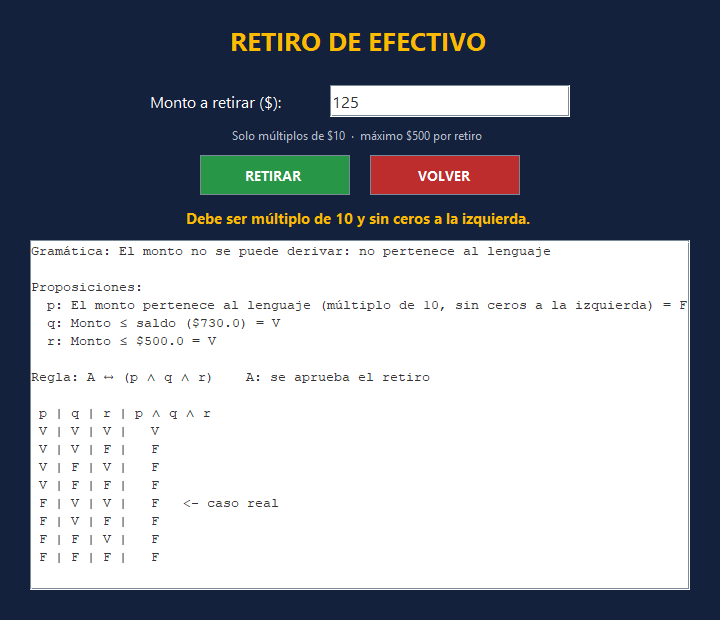
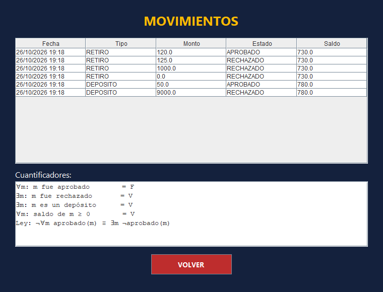

# 🏧 Cajero Automático Simplificado

Sistema de escritorio en **Java (NetBeans + Maven)** con arquitectura **Modelo–Vista–Controlador**, que toma **decisiones automáticas aplicando lógica proposicional y de predicados**. Cada operación del cajero (ingreso, retiro y depósito) se aprueba o se rechaza evaluando una proposición compuesta, y el sistema muestra al usuario la tabla de verdad y la regla de inferencia que justifica el resultado.

| | |
|---|---|
| **Universidad** | Universidad de las Fuerzas Armadas ESPE – Sede Santo Domingo |
| **Departamento** | Ciencias de la Computación – DCCOSS |
| **Asignatura** | Modelos Discretos de la Ingeniería |
| **Proyecto** | Proyecto ABP – Unidad 1: Lógica proposicional y funcional |
| **Grupo** | Grupo 2 – Pérez Derlys, Pindo Alejandro |
| **NRC** | 32798 – 3trc ITIN |
| **Docente** | Ing. Javier Cevallos |
| **Periodo** | Septiembre 2026 – Febrero 2027 |

---

## 📌 Problema que resuelve

Un cajero automático debe decidir sin ambigüedad: o permite la operación o la rechaza. Si estas decisiones se programan sin un modelo claro, aparecen errores como aceptar un retiro mayor al saldo o permitir el ingreso a una cuenta bloqueada. Además, el usuario necesita saber **por qué** se rechazó su operación.

**Solución:**
- Cada regla del negocio se traduce a una **proposición compuesta**, y la decisión del cajero es su **valor de verdad**.
- Cuando una operación se rechaza, el sistema usa **Modus Tollens y De Morgan** para indicar exactamente qué condición falló.

---

## ⚙️ Funcionalidades

| Ventana | Qué hace |
|---|---|
| **Ingreso** | Valida la cuenta y el PIN. Tras 3 PIN incorrectos, bloquea la cuenta. |
| **Menú** | Muestra el titular y el saldo, y dirige a cada operación. |
| **Retiro** | Retira montos múltiplos de 10, sin superar el saldo ni $500. |
| **Depósito** | Deposita montos enteros positivos de hasta $5000. |
| **Movimientos** | Muestra el historial y evalúa cuantificadores ∀ y ∃ sobre él. |

### Cuentas de prueba

| Cuenta | PIN | Titular | Saldo inicial |
|---|---|---|---|
| 1001 | 1234 | Juan Pérez | $850.00 |
| 1002 | 4321 | María López | $2300.00 |

> Los datos se cargan en memoria al iniciar el programa; al cerrarlo, todo vuelve a su estado inicial.

---

## 🧠 Lógica aplicada (temas de la Unidad 1)

### 1. Proposiciones y tablas de verdad

Las proposiciones se escriben en forma **afirmativa**; la negación va dentro de la fórmula. `A` significa «se permite la operación».

| Operación | Proposiciones | Regla |
|---|---|---|
| **Ingreso** | p: la cuenta existe · q: el PIN es correcto · r: la cuenta está bloqueada | **A ↔ (p ∧ q ∧ ¬r)** |
| **Retiro** | p: el monto es múltiplo de 10 sin ceros a la izquierda · q: monto ≤ saldo · r: monto ≤ $500 | **A ↔ (p ∧ q ∧ r)** |
| **Depósito** | p: el monto es entero positivo sin ceros a la izquierda · q: monto ≤ $5000 | **A ↔ (p ∧ q)** |

El sistema genera en pantalla la tabla completa (2ⁿ filas) y marca la fila del **caso real**.

Tabla del ingreso:

| p | q | r | ¬r | p ∧ q ∧ ¬r |
|:-:|:-:|:-:|:-:|:-:|
| V | V | V | F | F |
| **V** | **V** | **F** | **V** | **V** ✔ |
| V | F | V | F | F |
| V | F | F | V | F |
| F | V | V | F | F |
| F | V | F | V | F |
| F | F | V | F | F |
| F | F | F | V | F |

### 2. Ley de De Morgan y doble negación

Cuando se rechaza una operación, el sistema indica qué falló:

```
¬(p ∧ q ∧ ¬r) ≡ ¬p ∨ ¬q ∨ ¬¬r ≡ ¬p ∨ ¬q ∨ r
```

### 3. Modus Ponens y Modus Tollens

- **Operación aprobada (Modus Ponens):** `[(p ∧ q ∧ r) → A] ∧ (p ∧ q ∧ r) ⇒ A`
- **Operación rechazada (Modus Tollens):** `[A → (p ∧ q ∧ r)] ∧ ¬(p ∧ q ∧ r) ⇒ ¬A`
- **Bloqueo de cuenta (silogismo hipotético):** `[(f → b) ∧ (b → ¬A)] ⇒ (f → ¬A)`

### 4. Cuantificadores

Dominio M = movimientos de la sesión.

| Expresión | Significado |
|---|---|
| ∀m Aprobado(m) | Todos los movimientos fueron aprobados |
| ∃m ¬Aprobado(m) | Existe al menos un movimiento rechazado |
| ∃m Depósito(m) | Existe al menos un depósito |
| ∀m SaldoNoNegativo(m) | Ningún movimiento dejó el saldo negativo |

Se verifica la ley **¬∀m Aprobado(m) ≡ ∃m ¬Aprobado(m)**.

### 5. Método de demostración

Se usa la **demostración por contrapositiva**: «si el retiro se aprueba, entonces el monto no supera el saldo» equivale a «si el monto supera el saldo, el retiro no se aprueba». Por eso **∀m SaldoNoNegativo(m)** siempre es verdadero.

### 6. Alfabeto, lenguaje y gramática de las entradas

- **Alfabeto:** Σ = {0, 1, 2, 3, 4, 5, 6, 7, 8, 9}
- **Lenguaje del PIN:** L_PIN = { w ∈ Σ* : |w| = 4 }
- **Gramática del monto de retiro** (múltiplos de 10, sin cero inicial):

```
S → A0
A → X | XB
B → Y | YB
X → 1 | 2 | … | 9
Y → 0 | 1 | … | 9
```

Derivación de `120`: S ⇒ A0 ⇒ XB0 ⇒ 1B0 ⇒ 1Y0 ⇒ 120.

Si la entrada no pertenece a Σ* (por ejemplo `abc`), no es una proposición y se rechaza antes de evaluar.

---

## 🔀 Modelo del sistema con autómatas finitos

### Autómata del ingreso (bloqueo por intentos)



### Grafo de navegación entre ventanas



### Autómata que reconoce el monto de retiro



---

## 🏗️ Arquitectura MVC

```
src/main/java
├── com/mycompany/cajeroautomatico/CajeroAutomatico.java   ← main
├── Model/
│   ├── Cuenta.java        datos de la cuenta, PIN, intentos y bloqueo
│   ├── Movimiento.java    registro de cada operación
│   ├── Cajero.java        reglas de ingreso, retiro y depósito
│   └── Logica.java        tablas de verdad, inferencias, De Morgan, cuantificadores, gramática
├── View/                  JFrame Form (NetBeans GUI Builder)
│   ├── VistaLogin   ├── VistaMenu   ├── VistaRetiro
│   ├── VistaDeposito └── VistaMovimientos
└── Controller/            un controlador por ventana
```

**Flujo:**
1. La **Vista** recibe el clic.
2. El **Controlador** lee los datos y llama al **Modelo**.
3. El Modelo evalúa p, q, r y decide.
4. El Controlador muestra el mensaje y la explicación lógica en la Vista.

---

## ▶️ Cómo ejecutar

**Requisitos:**
- JDK 17 o superior
- Apache NetBeans (con soporte Maven)

**Pasos:**
1. Clonar el repositorio:
   ```bash
   git clone https:https://github.com/japindo-arch/Proyecto-U1-G2-CajeroAutomatico.git
   ```
2. En NetBeans: **File → Open Project** y elegir la carpeta del repositorio.
3. Clic derecho en el proyecto → **Clean and Build** → **Run**.
4. Ingresar con la cuenta **1001** y el PIN **1234**.

---

## 🧪 Casos de prueba

| Prueba | Entrada | Resultado esperado |
|---|---|---|
| Cuenta inexistente | 000 / 000 | Rechazado: falla ¬p, ¬q |
| PIN incorrecto ×3 | 1002 / 0000 | Cuenta bloqueada (silogismo hipotético) |
| Ingreso correcto | 1001 / 1234 | Abre el menú (Modus Ponens) |
| Retiro válido | 120 | Aprobado, saldo $730 |
| Retiro no múltiplo de 10 | 125 | Rechazado: falla ¬p |
| Retiro excesivo | 1000 | Rechazado: falla ¬q y ¬r |
| Entrada no numérica | abc | No es proposición, se rechaza |
| Depósito válido | 50 | Aprobado |
| Depósito excesivo | 9000 | Rechazado: falla ¬q |

---

## 🖼️ Capturas

| Ingreso | Bloqueo |
|---|---|
|  |  |
| **Menú** | **Retiro aprobado** |
|  |  |
| **Retiro rechazado** | **Movimientos y cuantificadores** |
|  |  |

---

## 📚 Referencias

- Epp, S. S. (2012). *Matemáticas discretas con aplicaciones* (4.ª ed.). Cengage Learning.
- Krasner, G. E. y Pope, S. T. (1988). A cookbook for using the model-view-controller user interface paradigm in Smalltalk-80. *Journal of Object-Oriented Programming, 1*(3), 26–49.
- Rosen, K. H. (2019). *Discrete mathematics and its applications* (8.ª ed.). McGraw-Hill Education.
